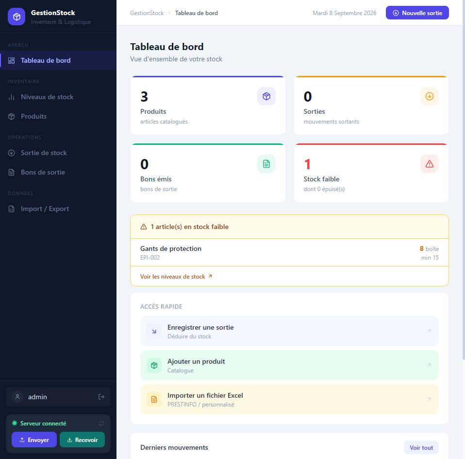
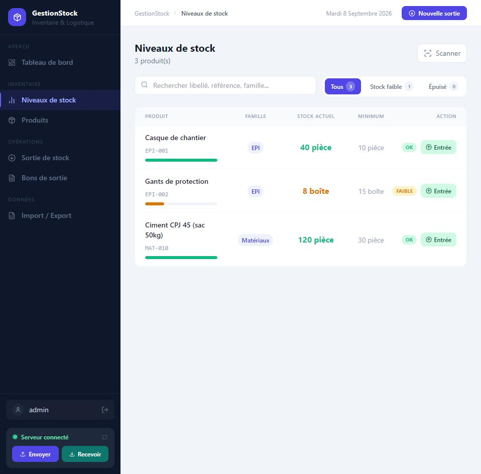
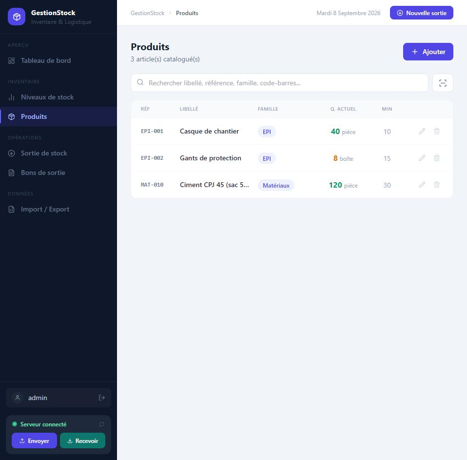
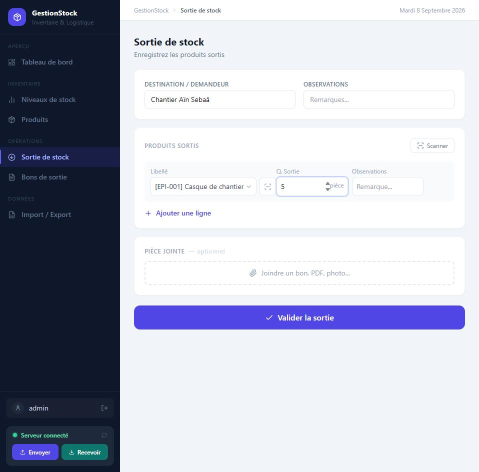
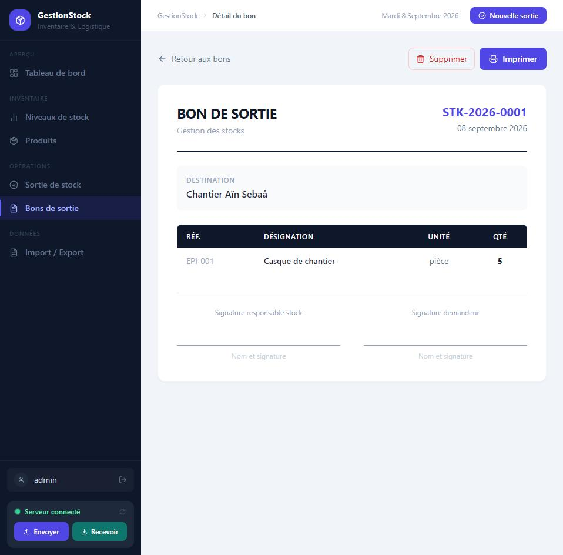

# GestionStock

Offline-first inventory management system for small and medium businesses, built with React and Express. Stock operations (products, movements, delivery notes) keep working without an internet connection, and are synchronized automatically with a central SQLite server so several workstations share the same data.

## Features

- **Product catalog** — reference, category, unit, barcode, minimum stock threshold
- **Stock levels** — available quantity per product, computed from initial stock + movements, with low-stock / out-of-stock filters
- **Stock movements** — record stock-outs (available stock shown per line, duplicate lines summed, scanning the same product twice increments its quantity), grouped stock receptions, or single entries from the stock levels page; an unfinished entry form is kept as a draft
- **Bons** — stock-out (`STK-…`), reception (`REC-…`), purchase order (`CMD-…`) and inventory (`INV-…`) documents, with destination / supplier, optional attached file (10 MB max) and print support
- **Physical inventory** — count all products or one family (manual entry or barcode scan, one scan = +1), see the gaps and their value, then validate: the stock of each counted product is adjusted and an `INV` document keeps expected vs. counted quantities; the count in progress is kept as a draft
- **Replenishment** — products at or below their minimum, grouped by usual supplier, with a suggested quantity up to the target stock (default: twice the minimum) minus what is already on order; one click prepares the purchase order. Orders show their progress (pending / partially received / received) and « Réceptionner » pre-fills a reception with the remaining quantities
- **Stock value & reports** — unit price per product, stock value (total, per family), consumption per product and per destination over a period, dormant stock, activity per user, Excel export of the report
- **Traceability** — every movement and document records the user who entered it (shown in documents, history, dashboard; filter by user in the document list)
- **Movement history** — per product, with the resulting stock after each movement and its author
- **Excel import / export** — bulk product import, data export
- **Authentication & users** — JWT login, login throttling, password change, user management for administrators (roles `admin` / `user`)
- **Offline-first** — all data lives locally in the browser (IndexedDB); the app is fully usable without a server
- **Multi-device sync** — automatic, row-level merge between workstations through a central Express + SQLite server

## Tech stack

**Frontend**: React 19, Vite, Tailwind CSS, [Dexie](https://dexie.org/) (IndexedDB), `@zxing` (barcode scanning), `xlsx`, `react-to-print`

**Backend**: Node.js, Express, SQLite (`better-sqlite3`), Zod (schemas shared with the frontend in `shared/schemas.ts`), JWT (`jsonwebtoken`), `bcryptjs`

## Architecture

```
Browser (per workstation)
┌─────────────────────────────┐
│  React UI                   │
│    │                        │
│    ▼                        │
│  IndexedDB (Dexie)          │  ← works fully offline
└──────────────┬───────────────┘
               │  push / pull  (JWT-authenticated)
               ▼
        Express API (server/)
               │
               ▼
        SQLite (server/stock.db)
```

Each workstation keeps a full local copy of the data in IndexedDB and can operate offline indefinitely. When the server is reachable, the app synchronizes automatically (on startup, every minute, a few seconds after each local change, and with the « Synchroniser » button). Sync is a **row-level merge**, not a replace:

- **Global ids** — every row has a `uid` (UUID) shared by all workstations; local auto-increment ids stay private to each workstation, and relations are translated to uids on the wire.
- **Push** sends only the rows modified locally (`dirty` flag set by Dexie hooks) plus pending deletions (tombstones), in batches of ~4 MB.
- **Pull** is incremental: the server keeps a global revision counter and returns only the rows written since the client's last pull (and not by that client itself).
- **Conflicts** — the most recent modification (`updatedAt`) wins, row by row. Movements are separate rows, so stock-outs entered on two workstations add up instead of overwriting each other.
- **Deletions** propagate to other workstations, except a product still used by movements on a workstation: that workstation keeps it and sends it back.
- **Bon numbers** are computed locally, so two workstations offline at the same time can produce the same number; the bons are still distinct and the list flags the duplicate.

### Local schema evolution

The local schema (`src/db.ts`) evolved through four Dexie versions:

```
v1: products, movements, bons, bonItems
v2: + barcode on products
v3: + a dedicated "sorties" (stock-outs) table
v4: sorties merged into bons (bons gain isFormal + attached file fields)
    → existing "sorties" rows are migrated automatically into bons/bonItems
v5: merge sync — uid / updatedAt / dirty on every row, movements linked to their bon by bonId,
    tombstones table; existing rows get the uid "legacy-<table>-<id>"
v6: + orderUid index on bons (reception → purchase order). New optional fields, no data migration:
    products.unitPrice / supplier / maxStock, movements.createdBy, bons.createdBy / orderUid,
    bonItems.expected (inventory: expected quantity)
```

Inventory adjustments are ordinary `entree` / `sortie` movements attached to the `INV` document, so stock levels need no special case; reports exclude them from consumption. Purchase orders have no movements: stock only changes when they are received. Amounts are computed with the current unit price.

The server performs the matching migration on startup: the old full-replace tables are converted into the `records` table with the same `legacy-<table>-<id>` uids (and kept as `legacy_*` tables as a backup), so a workstation that was in sync before the upgrade finds its rows again.

**Upgrading from the full-replace sync**: before deploying, make every workstation send its pending changes with the old version (« Envoyer »), then pull once. A workstation that still has unsent changes at upgrade time pushes all its rows on its first sync: nothing is lost, but rows deleted elsewhere in the meantime may come back.

Pure stock logic (stock levels and value, low-stock status, bon numbering, Excel import maths, order progress, replenishment suggestions, inventory gaps) lives in `src/lib/stock.ts`, report aggregations in `src/lib/reports.ts`; both are unit-tested.

## Getting started

### Prerequisites

- Node.js 20+ (no database server needed: SQLite is embedded)

### Install

```bash
npm install
```

### Configure

```bash
cp .env.example .env               # frontend: API base URL (optional, defaults to localhost:3001), VITE_CURRENCY (optional, e.g. DH or €)
cp server/.env.example server/.env # backend: JWT secret, admin credentials
```

Edit `server/.env` and set `ADMIN_USERNAME` / `ADMIN_PASSWORD`. If you skip the password, the server generates a random admin password on first run and prints it once to the console. Without `JWT_SECRET`, a secret is generated once and stored in the database, so sessions survive restarts. Optional: `CORS_ORIGIN` (comma-separated allowed origins; all origins by default — the API uses bearer tokens, not cookies) and `BODY_LIMIT` (max request size, `50mb` by default). Additional accounts are created from the « Utilisateurs » page (administrators only); passwords need at least 8 characters, and 5 failed logins for the same account lock it for 15 minutes. The database file defaults to `server/stock.db` (override with `DB_PATH`); tables are created automatically on startup.

### Run

```bash
npm run start   # runs the Vite dev server + the Express API together
```

- Frontend: http://localhost:5173
- API: http://localhost:3001

Other scripts: `npm run dev` (frontend only), `npm run server` (API only), `npm run build`, `npm run typecheck`, `npm run lint`, `npm test`.

The service worker (offline cache) is only registered in production builds.

## Testing

```bash
npm test
```

Uses Node's built-in test runner (`node --test`, via `tsx`):

- `tests/stock-calculation.test.ts` — stock-calculation and stock-sufficiency logic
- `tests/stock-lib.test.ts` — stock levels/status, bon numbering, Excel import maths, schema coercion
- `tests/stock-features.test.ts` — stock value, CMD/INV numbering, order progress, replenishment suggestions, inventory gaps
- `tests/reports.test.ts` — periods, consumption per product / destination (inventory adjustments excluded), dormant stock
- `tests/sync-client.test.ts` — two simulated workstations (fake IndexedDB) syncing through a real test server: id translation, concurrent stock-outs, bon deletion, conflicts, product deletion vs. usage, inventory and purchase order received on another workstation, local v5 migration
- `server/tests/auth.test.ts` — login, token validation
- `server/tests/users.test.ts` — user management, last-admin protection, login throttling
- `server/tests/sync.test.ts` — merge push/pull, last-write-wins, incremental pull, deletions, author stamping, new fields round trip, legacy table migration

Server tests need no setup: each test file starts the app on an ephemeral port with a temporary SQLite database.

## Screenshots






